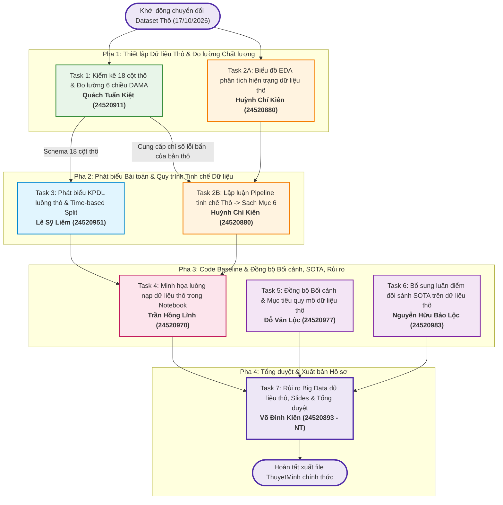

# HƯỚNG DẪN VÀ KẾ HOẠCH ĐIỀU CHỈNH THUYẾT MINH ĐỀ TÀI (LAB 3)
## CHUYỂN ĐỔI DATASET ĐẦU VÀO TỪ BẢN NỀN TẢNG SANG BẢN THÔ (NOAA AIS 2025 RAW)

**Học phần:** DS317 - Khai phá dữ liệu trong doanh nghiệp (UIT)  
**Nhóm thực hiện:** Nhóm 03 - Lớp DS317.P11 / DS317.R11  
**Đề tài:** Dự báo thời điểm cập cảng của tàu biển thay thế ETA tự khai báo *(Prediction of Vessel Port Arrival Time Replacing Self-Reported ETA)*  

---

### I. MỤC ĐÍCH VÀ BỐI CẢNH ĐIỀU CHỈNH CHIẾN LƯỢC

1. **Lý do điều chỉnh:**
   - Nhằm **thỏa mãn tuyệt đối yêu cầu của giảng viên hướng dẫn**: Đề tài khai phá dữ liệu phải bắt đầu từ **bộ dữ liệu thô ban đầu (Raw Data)** của doanh nghiệp/ngành thực tế, thay vì lấy một tập dữ liệu đã qua tiền xử lý, gọt giũa và lọc sạch sẵn.
   - Thể hiện rõ nét toàn bộ giá trị gia tăng và kỹ năng của nhóm qua từng bước: Đo lường chất lượng dữ liệu thô $\rightarrow$ Nhận diện lỗi cảm biến, dị biệt, khuyết thiếu $\rightarrow$ Thiết kế Pipeline tinh chế dữ liệu lớn $\rightarrow$ Chế tác đặc trưng và huấn luyện mô hình.

2. **Chiến lược "Trước vs. Sau" (Before vs. After) chuẩn mực:**
   - **Mục 5 (Mô tả dữ liệu):** Tập trung kiểm kê, xây dựng từ điển và đo lường độ đo chất lượng 6 chiều trên **Bản thô** (`320,776,922` bản ghi gốc pre-split, `18` cột `SCHEMA_RAW_LABELED`, và `256,935,254` bản ghi `RAW18` sau chia `209,615,498` train + `47,319,756` test).
   - **Mục 6 (Tiền xử lý dữ liệu):** Đóng vai trò là "cầu nối tinh chế dữ liệu", mô tả chi tiết quy trình biến đổi `320,776,922` dòng thô pre-split (`256,935,254` dòng `RAW18` sau chia) thành **`92,681,850` dòng chất lượng cao** (`68,489,376` train + `24,192,474` test ở `02_ban_nen_tang_22_thuoc_tinh` / `03_ban_tien_xu_ly_27_thuoc_tinh`).
   - **Mục 7 & Mục 8 (Mô hình & Kịch bản thực nghiệm):** Tiếp tục kế thừa tập dữ liệu sạch `92,681,850` dòng (cùng đối chứng streaming trên `RAW18` / `RAW_CC`) để huấn luyện mô hình cơ sở (Ridge Regression Baseline) và các mô hình nâng cao (Engine v2).

---

### II. BẢNG SỐ LIỆU ĐỐI CHUẨN DÙNG CHUNG (SINGLE SOURCE OF TRUTH)
*(Tất cả 7 thành viên bắt buộc phải sử dụng thống nhất các con số chính thức dưới đây, tuyệt đối không tự ý làm tròn hoặc phỏng đoán)*

| Hạng mục chỉ số | Dữ liệu Thô ban đầu (Raw Input - Mục 5) | Dữ liệu sau Tiền xử lý (ML-Ready - Mục 6, 7, 8) |
| :--- | :--- | :--- |
| **Quy mô số dòng** | **320,776,922 bản ghi pre-split** / **256,935,254 bản ghi `RAW18`** (`209,615,498` train + `47,319,756` test) | **92,681,850 bản ghi sạch** (`68,489,376` train + `24,192,474` test; tỷ lệ giữ `36.07%` so với `RAW18`, `28.89%` so với `pre-split`) |
| **Số lượng thuộc tính** | **18 cột** (`SCHEMA_RAW_LABELED`) | **22 cột** (`Base22`) / **27 cột** (`Prep27`) |
| **Dung lượng lưu trữ** | **13.15 GB** dữ liệu nén gốc (`NOAA_AIS_2025_RAW/`: `31` `.csv.zst`, `1` `.zip`, `1` `.tif`); `6,831.90 MB` Parquet Snappy `RAW18` | **3,472.20 MB** (`Base22`: `2,571.86 MB` train + `900.34 MB` test) / **3,948.84 MB** (`Prep27`: `2,924.00 MB` train + `1,024.84 MB` test) Parquet Snappy |
| **Phân chia chuyến hành trình (`trip_id`)** | Xác định từ `noaa_ais_2025_trip_split_manifest.parquet` (`TRAIN_PURE`, `TEST_PURE`, loại bỏ `TRAIN_CROSSING_EXCLUDED`) | Bảo toàn tính độc lập theo quý (`Q1-Q3` Train vs `Q4` Test, không rò rỉ biên quý) |
| **Số lượng tàu độc nhất (`mmsi`)** | **11,632 tàu thương mại** trong tập `pre-split` (`RAW_PRE_SPLIT/full_summary.json`, Cargo `70-79` & Tanker `80-89`) | Nhóm tàu thương mại `Cargo 70-79` & `Tanker 80-89` |
| **Tỷ lệ khuyết thiếu thân vỏ** | **Pre-split 320.78M:** `Draft: 2.46% \| Length: 0.47% \| Width: 1.23%` (`RAW18 256.94M`: `Draft: 2.10% \| Length: 0.40% \| Width: 1.07% \| Heading: 3.17% \| Cargo: 0.64%`) | **0.00% tuyệt đối** cho thân vỏ (`length, width, draft`) trên `Base22`/`Prep27` (`0` ô khuyết ngoài `cargo` `0.50%`) |
| **Dải vận tốc di chuyển (SOG)** | `0.0 - 99.9 knots` (nhiều lỗi vọt tốc sensor & neo đậu) | **1.0 - 39.9 knots** (vận tốc kinh tế chuẩn hàng hải) |
| **Trạng thái hành hải (Status)** | Đầy đủ mọi trạng thái (tàu neo đậu `status 1 & 5` gây nhiễu lớn) | **Chỉ giữ tàu đang hành trình** (`status != 1.0` và `!= 5.0`) |
| **Khoảng cách tới bến đích** | Đã gán nhãn bến (`berth_lon`, `berth_lat`) trong `SCHEMA_RAW_LABELED` | **Đã tính `Dist_To_Berth_NM`** (hải lý) (Haversine WGS84) |
| **Tín hiệu tương quan hành hải** | **Pearson r = +0.2589** (`RAW18`) / `+0.2807` (`pre-split`) | **Pearson r = +0.50971** (`Base22`, `92.68M`) / `+0.7772` (mẫu lọc `pre-split` `90.59M`) |
| **Kết quả Baseline Test Q4** | **`RAW_CC` (`N_Test = 44,348,487`):** Dummy MAE = **152.09h** / Ridge MAE = **175.34h** (`RAW18`: Dummy `156.47h` / Ridge `299.71h`) | **`BENCHMARK_3_VERSIONS` (`N_Test = 24,192,474`):** `Base22` Dummy **129.20h** -> Ridge **115.47h**; `Prep27` Dummy **129.20h** -> Ridge **115.27h** |

---

### III. SƠ ĐỒ PHỤ THUỘC GIỮA CÁC NHIỆM VỤ (TASK DEPENDENCY GRAPH)

---

### IV. BẢNG TỔNG HỢP MA TRẬN PHÂN CÔNG NHIỆM VỤ ĐIỀU CHỈNH

| Mã Task | Tên nhiệm vụ điều chỉnh | Thành viên phụ trách | MSSV | Vị trí chèn trong file Word gốc | Mức độ ưu tiên | Hạn chót |
| :---: | :--- | :--- | :---: | :--- | :---: | :---: |
| **TASK-RAW-01** | Kiểm kê 18 cột thô & Đo lường 6 chiều DAMA-DMBOK | **Quách Tuấn Kiệt** | 24520911 | Mục 5.1, 5.2, 5.3 & File Excel | **Khẩn cấp** | **18/10/2026** |
| **TASK-RAW-02** | EDA hiện trạng dữ liệu thô & Quy trình tinh chế Mục 6 | **Huỳnh Chí Kiên** | 24520880 | Mục 5.4 & Mục 6 (tiểu mục 6.1-6.6) | **Khẩn cấp** | **18/10/2026** |
| **TASK-RAW-03** | Cập nhật Bài toán KPDL trên dữ liệu thô & Time-based Split | **Lê Sỹ Liêm** | 24520951 | Mục 3 & Mục 8 (tiểu mục 8.1) | **Quan trọng** | **19/10/2026** |
| **TASK-RAW-04** | Minh họa luồng nạp dữ liệu thô & Hàm làm sạch trong Code | **Trần Hồng Lĩnh** | 24520970 | Notebook Code Kaggle & Mục 7 | **Quan trọng** | **19/10/2026** |
| **TASK-RAW-05** | Cập nhật Bối cảnh & Mục tiêu SMART theo quy mô thô 320M | **Đỗ Văn Lộc** | 24520977 | Mục 1 & Mục 2 (Bảng 2.1) | **Bình thường** | **19/10/2026** |
| **TASK-RAW-06** | Bổ sung luận điểm đối sánh SOTA trên dữ liệu thô lớn | **Nguyễn Hữu Bảo Lộc** | 24520983 | Mục 4 (tiểu mục 4.3) & Mục 13 | **Bình thường** | **19/10/2026** |
| **TASK-RAW-07** | Rủi ro Big Data dữ liệu thô 320M dòng, Slides & Tổng duyệt | **Võ Đình Kiên (NT)** | 24520893 | Mục 12, Slides & Đóng gói ZIP | **Tổng hợp** | **20/10/2026** |

---

### V. BẢN HƯỚNG DẪN CHI TIẾT TỪNG NHIỆM VỤ

#### 1. QUÁCH TUẤN KIỆT (MSSV: 24520911)
**Nhiệm vụ:** Hoàn thiện bảng kiểm kê tài sản dữ liệu thô, lập từ điển 18 thuộc tính gốc và đo lường độ đo chất lượng 6 chiều trên dữ liệu thô.

* **Công việc cụ thể:**
  1. **Bảng 5.1 (Kiểm kê 7 tiêu chí):**
     - Tiêu chí Quy mô: Báo cáo rõ dữ liệu nén ban đầu gồm **13.15 GB** (`NOAA_AIS_2025_RAW/`: `31` `.csv.zst`, `1` `.zip`, `1` `.tif`), tương ứng **320,776,922 bản ghi gốc `pre-split`** (`11,632` tàu thương mại `mmsi`) và **256,935,254 bản ghi `RAW18`** sau chia (`209,615,498` train + `47,319,756` test, `6,831.90 MB` Parquet Snappy), trải dài 365 ngày của năm 2025.
     - Tiêu chí Chất lượng: Nêu rõ hiện trạng khuyết thiếu ban đầu trên `pre-split` (`Draft: 2.46%`, `Length: 0.47%`, `Width: 1.23%`, `Cargo: 0.73%`) và trên `RAW18` (`Draft: 2.10%`, `Length: 0.40%`, `Width: 1.07%`, `Cargo: 0.64%`, `Heading: 3.17%`).
  2. **Bảng 5.2 (Từ điển dữ liệu thô 18 cột `SCHEMA_RAW_LABELED`):**
     - Sử dụng đúng 18 thuộc tính của `SCHEMA_RAW_LABELED`: `mmsi`, `trip_id`, `base_date_time`, `longitude`, `latitude`, `sog`, `cog`, `heading`, `status`, `vessel_type`, `length`, `width`, `draft`, `cargo`, `berth_lon`, `berth_lat`, `ata_time`, `Target_Hours`.
     - Báo cáo số lượng bản ghi hợp lệ và tỷ lệ khuyết thiếu (% missing) thực tế trên dữ liệu thô (`05_Output_Cac_Notebook/06_DS317_Tong_Hop_Xuat_So_Lieu_BTVN/DAMA/data_dictionary_raw18_stats.csv`).
  3. **Mục 5.3 (Đo lường chất lượng 6 chiều DAMA-DMBOK):**
     - **BẮT BUỘC ĐO TRÊN DỮ LIỆU THÔ (`RAW18`, `256,935,254` bản ghi)** để chỉ ra lỗi chất lượng dữ liệu (`05_Output_Cac_Notebook/06_DS317_Tong_Hop_Xuat_So_Lieu_BTVN/DAMA/table_4_1_dama_raw_six_dimensions_overall.csv`):
       * *Tính đầy đủ:* Mức bản ghi đạt `93.5626%` (`240,395,409 / 256,935,254` bản ghi đủ 18 cột, tức `16,539,845` bản ghi bị khuyết ít nhất 1 trường; riêng `draft` thiếu `5,404,126` dòng = `2.10%`).
       * *Tính nhất quán:* Đạt `36.6940%` (`94,279,701 / 256,935,254`), vi phạm `63.31%` do tàu neo đậu `status 1 & 5`, vận tốc ngoài dải `[1.0, 40.0]` kn và quan trắc ngoài cửa sổ `168h`.
       * *Tính duy nhất:* Đạt `99.7228%` (`256,223,135 / 256,935,254`, tức `712,119` bản ghi trùng cặp khóa `(mmsi, base_date_time)` chiếm `0.2772%` do vùng phủ sóng chồng lấn giữa các trạm bờ VHF USCG).
  4. **Sản phẩm bàn giao:** Cập nhật tệp Excel `Lab3_DS317_Nhom03_DataInventory.xlsx` và nhập trực tiếp vào Mục 5.1, 5.2, 5.3 trên file Word gốc.

---

#### 2. HUỲNH CHÍ KIÊN (MSSV: 24520880)
**Nhiệm vụ:** Trực quan hóa hiện trạng dữ liệu thô và xây dựng toàn diện Chương 6 (Phương pháp tiền xử lý tinh chế dữ liệu từ Thô sang Sạch).

* **Công việc cụ thể:**
  1. **Mục 5.4 (Kết quả EDA):**
     - Bổ sung phân tích hiện trạng dữ liệu thô: Biểu đồ phân phối vận tốc SOG thô (thấy đỉnh nhọn tại $0$ kn do tàu neo buộc bến và các điểm ngoại lai $>40$ kn do lỗi sensor); biểu đồ cơ cấu các loại tàu cho thấy cần phải lọc phân nhóm Cargo/Tanker.
  2. **Mục 6 (Phương pháp tiền xử lý dữ liệu - TRỌNG TÂM):**
     - Viết chi tiết quy trình tinh chế biến đổi từ `320,776,922` dòng thô pre-split (`256,935,254` dòng `RAW18`) thành **`92,681,850` dòng sạch** (`Base22`/`Prep27`):
       * *Tiểu mục 6.1 (Kiến trúc 2-Pass Rolling Stream):* Thuật toán quét Pass 1 lập Catalog cập bến (`ata_catalog`) và Pass 2 gán nhãn `Target_Hours`, tách Train/Test theo biên giới quý (`Q1-Q3` vs `Q4`).
       * *Tiểu mục 6.2 (Bộ lọc 3 tầng):* Lọc vận tốc chuẩn hàng hải $1.0 \le SOG \le 40.0$ kn; lọc trạng thái hành hải (loại status 1 & 5); lọc loại tàu thương mại (mã ITU-R 70-89).
       * *Tiểu mục 6.3 (Xử lý khuyết thiếu - Domain-based Imputation):* Giải thích thuật toán điền khuyết phân tầng (`mmsi -> vessel_type -> group`) đưa tỷ lệ thiếu kích thước thân vỏ từ `2.10%` (`RAW18`) / `2.46%` (`pre-split`) về **0.00% tuyệt đối** (kèm Bảng 6.1 kết quả kiểm chứng mask-and-recover).
       * *Tiểu mục 6.4 (Chế tác đặc trưng - Feature Engineering):* Công thức tính cự ly trắc địa Haversine/WGS84 `Dist_To_Berth_NM`, chế tác diện tích cản gió `Area_Proxy` và thể tích choán nước `Volume_Proxy`.
       * *Tiểu mục 6.5 & 6.6:* Xử lý target lệch phải và giải thích lý do không áp dụng giảm chiều PCA (giữ nguyên ngữ nghĩa vật lý).

---

#### 3. LÊ SỸ LIÊM (MSSV: 24520951)
**Nhiệm vụ:** Cập nhật Phát biểu bài toán KPDL trên dữ liệu thô và Sơ đồ phân chia Time-based Split.

* **Công việc cụ thể:**
  1. **Mục 3 (Phát biểu bài toán khai phá dữ liệu):**
     - Bảng phát biểu bài toán:
       * *Cho trước:* Bộ dữ liệu thô NOAA AIS 2025 gồm `320,776,922` bản ghi pre-split (`256,935,254` bản ghi `RAW18` sau chia) của các tàu hàng và tàu dầu tại vùng biển Hoa Kỳ.
       * *Đầu vào:* Bản tin định vị AIS thô (`18` cột `SCHEMA_RAW_LABELED`), được đưa qua pipeline tự động lọc nhiễu, điền khuyết và trích xuất đặc trưng (`22` cột `Base22` / `27` cột `Prep27`).
       * *Đầu ra:* Số giờ di chuyển thực tế còn lại (`Target_Hours`) và mốc giờ cập bến dự báo (`Predicted ATA`) kèm khoảng an toàn 90%.
  2. **Mục 8.1 (Kịch bản phân chia tập dữ liệu Time-based Split):**
     - Trình bày sơ đồ phân chia theo dòng thời gian thực tế: **Tập Train (01/01 - 30/09/2025, 9 tháng đầu năm, `68,489,376` dòng sau lọc trên `Base22`/`Prep27`; `209,615,498` dòng `RAW18`)** và **Tập Test (01/10 - 31/12/2025, 3 tháng cuối năm, `24,192,474` dòng sau lọc trên `Base22`/`Prep27`; `47,319,756` dòng `RAW18`)**.
     - Khẳng định nguyên tắc chống rò rỉ thông tin: **Mốc cắt thời gian được xác lập ngay trên dữ liệu thô**; toàn bộ các bước tính toán trung vị điền khuyết và chuẩn hóa đặc trưng chỉ được học (fit) trên tập Train và áp dụng (transform) sang tập Test.

---

#### 4. TRẦN HỒNG LĨNH (MSSV: 24520970)
**Nhiệm vụ:** Minh họa luồng nạp dữ liệu thô và hàm tiền xử lý trong Notebook Kaggle, bảo toàn kết quả Baseline.

* **Công việc cụ thể:**
  1. **Cập nhật Notebook `Lab3_DS317_Nhom03_Code.ipynb`:**
     - Bổ sung 1-2 cell đầu tiên: Minh họa việc đọc mẫu bản tin AIS thô (`18` cột `SCHEMA_RAW_LABELED`), in ra các dòng chứa giá trị khuyết thiếu thân vỏ và vận tốc $SOG = 0$.
     - Minh họa hàm tiền xử lý dữ liệu thô: Lọc dải vận tốc, loại bỏ status neo đậu và gọi hàm điền khuyết Domain Imputation trước khi nạp dữ liệu vào mô hình.
  2. **Mục 7.5 (Phương pháp khai phá dữ liệu dự kiến):**
     - Giữ nguyên công thức và lý giải toán học của hàm mất mát tùy biến Custom Asymmetric Loss (đạo hàm Gradient bậc 1 và Hessian bậc 2).
     - Cập nhật kết quả kiểm chứng mô hình cơ sở Ridge Regression Baseline trên tập Test Q4 theo số liệu chính thức: `BENCHMARK_3_VERSIONS` (`Prep27`: Ridge MAE = **115.27h** vs Dummy MAE = **129.20h**; `Base22`: Ridge MAE = **115.47h** vs Dummy MAE = **129.20h**) và đối chứng `RAW_CC` (`N_Test = 44,348,487`: Ridge MAE = **175.34h** vs Dummy MAE = **152.09h**).

---

#### 5. ĐỖ VĂN LỘC (MSSV: 24520977)
**Nhiệm vụ:** Đồng bộ hóa quy mô dữ liệu thô trong Mục 1 (Bối cảnh) và Mục 2 (Mục tiêu đề tài).

* **Công việc cụ thể:**
  1. **Mục 1 (Bối cảnh và lý do chọn đề tài):**
     - Nhấn mạnh: Dữ liệu AIS thu thập từ trạm bờ USCG trong thực tế luôn ở dạng thô với tần suất phát 2-10 giây/lần, chứa đựng lượng lớn nhiễu sóng và thông tin gián đoạn. Do đó, doanh nghiệp khai thác cảng cần một giải pháp khai phá dữ liệu tự động từ khâu làm sạch đến khâu dự báo.
  2. **Bảng 2.1 (Mục tiêu SMART):**
     - Mục tiêu 1: *Khai thác thành công bộ dữ liệu lớn NOAA AIS 2025 với quy mô `320,776,922` bản ghi thô pre-split (`13.15 GB` dữ liệu nén gốc; `256,935,254` bản ghi `RAW18` sau chia), xây dựng pipeline tiền xử lý tinh chế thu được `92,681,850` bản ghi chất lượng cao (`Base22`/`Prep27`) phục vụ dự báo*.

---

#### 6. NGUYỄN HỮU BẢO LỘC (MSSV: 24520983)
**Nhiệm vụ:** Bổ sung luận cứ đối sánh SOTA trên bộ dữ liệu lớn thô tại Mục 4.

* **Công việc cụ thể:**
  1. **Mục 4.3 (Khoảng trống nghiên cứu & Luận cứ đề tài):**
     - Bổ sung nhận định so sánh: *Trong 5 nghiên cứu SOTA đã khảo sát (El Mekkaoui 2023, Abdi 2024, Wang 2025, Saber 2025), đa số các tác giả thực nghiệm trên các bộ dữ liệu nhỏ hoặc dữ liệu đã qua tiền xử lý/giả lập nhân tạo. Đề tài của nhóm đối mặt trực tiếp với thách thức xử lý dữ liệu thô quy mô lớn `320.78` triệu bản ghi (`256.94M` `RAW18`) của toàn bộ bờ biển Hoa Kỳ, phản ánh trọn vẹn sự phức tạp của vận tải hàng hải thực tế*.
  2. **Mục 13 (Tài liệu tham khảo):** Đảm bảo giữ chuẩn trích dẫn IEEE và tệp `references.bib`.

---

#### 7. VÕ ĐÌNH KIÊN (MSSV: 24520893 - NHÓM TRƯỞNG)
**Nhiệm vụ:** Cập nhật phân tích rủi ro Big Data dữ liệu thô Mục 12, thiết kế Slides và tổng duyệt toàn bộ hồ sơ.

* **Công việc cụ thể:**
  1. **Mục 12 (Rủi ro kỹ thuật và phương án dự phòng):**
     - Rủi ro 1: Nhấn mạnh rủi ro tràn bộ nhớ RAM và quá tải đĩa khi xử lý `320.78` triệu dòng thô (`13.15 GB` nén gốc / `6,831.90 MB` Parquet `RAW18`). Biện pháp: Đã giải quyết thành công bằng kiến trúc Self-Checkpoint Engine kết hợp dọn dẹp đĩa lũy tiến (Progressive Disk Cleanup), duy trì RAM < 4 GB và đĩa < 10 GB trong suốt quá trình chạy.
  2. **Bộ Slides thuyết trình Buổi 6 (`Slides.pptx` & `.pdf`):**
     - Cập nhật sơ đồ luồng dữ liệu 4 tầng: *Dữ liệu thô (`320.78M` pre-split / `256.94M` `RAW18`) $\rightarrow$ Pipeline tiền xử lý $\rightarrow$ Dữ liệu sạch (`92.68M` `Base22`/`Prep27`) $\rightarrow$ Mô hình dự báo ATA*.
  3. **Tổng duyệt và kiểm tra đối chuẩn chéo 100%:**
     - Kiểm tra sự nhất quán giữa Báo cáo Word, File Excel kiểm kê, Slides và Code Kaggle. Đảm bảo toàn văn bản sử dụng dấu gạch ngang tiêu chuẩn `-` (ASCII 45).

---

### VI. QUY CHUẨN KỸ THUẬT VÀ LƯU Ý BẮT BUỘC KHI LÀM BÀI

1. **Quy chuẩn dấu gạch ngang:**
   - **BẮT BUỘC sử dụng duy nhất dấu gạch ngang tiêu chuẩn `-` (hyphen-minus, mã phím ASCII 45)**.
   - **TUYỆT ĐỐI KHÔNG** dùng dấu gạch ngang dài en-dash (`-`) hoặc em-dash (`-`).
2. **Nguyên tắc "Một nguồn sự thật" (Single Source of Truth):**
   - 100% các con số báo cáo bắt buộc phải sao chép chính xác từ **Bảng II (Bảng số liệu đối chuẩn dùng chung)** của tài liệu này. Không tự làm tròn sai lệch.
3. **Phối hợp làm việc trên hồ sơ chính thức:**
   - Các thành viên đối chiếu số liệu từ [`05_Output_Cac_Notebook/06_DS317_Tong_Hop_Xuat_So_Lieu_BTVN/`](../05_Output_Cac_Notebook/06_DS317_Tong_Hop_Xuat_So_Lieu_BTVN/) và cập nhật vào tệp [`Lab3_DS317.R11_Nhom03_ThuyetMinh.docx`](../01_Bai_Tap_Ve_Nha_Chinh_Thuc/BT3_Thuyet_Minh_De_Tai/Lab3_DS317.R11_Nhom03_ThuyetMinh.docx) trong kho lưu trữ chung.
   - Đúng **21:00 ngày 19/10/2026**, toàn bộ các mục phải được hoàn tất để Nhóm trưởng tiến hành tổng duyệt và xuất bản báo cáo chính thức.
